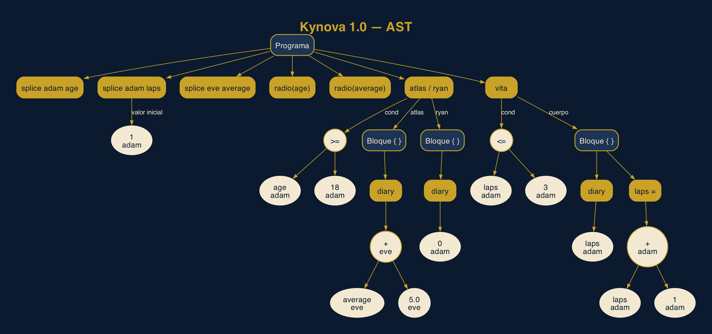

# Kynova 1.0 — "Rapture Edition"

Front-end del traductor de **Kynova** (`.kyn`), lenguaje educativo imperativo
del curso de Compiladores. Esta entrega (Semana 11) implementa:

```
Archivo .kyn → Flex → Tokens → Bison → AST inicial → Tabla de símbolos
```

**Equipo:** Jonathan Javier Soberanis Castillo · Javier Augusto Estrada Gordillo ·
Gustavo Adolfo Ortiz Gutiérrez

## Checklist de la entrega parcial

| Requisito                                   | Dónde está                                        |
|---------------------------------------------|---------------------------------------------------|
| Archivo Flex (`.l`) funcional               | `src/kynova.l`                                    |
| Archivo Bison (`.y`) funcional              | `src/kynova.y`                                    |
| Integración Flex + Bison                    | `Makefile`, `src/lexer.h`, `src/main.c`           |
| AST inicial para las construcciones         | `src/ast.h`, `src/ast.c`                          |
| Tabla de símbolos básica                    | `src/symtab.h`, `src/symtab.c`, `src/semantic.c`  |
| Prueba de un programa válido y uno inválido | `tests/valid/`, `tests/invalid/`, `make test`     |
| README con compilación y ejecución          | este archivo                                      |

## Requisitos

- Compilador de C con soporte C11 (`gcc` o `clang`)
- **Flex** 2.6 o superior
- **GNU Bison 3.6 o superior** (se usa `%define parse.error custom` para dar
  los mensajes de error en español)
- `make`

### macOS

El `bison` que trae macOS (2.3) es demasiado viejo. Instalar con Homebrew:

```sh
brew install bison flex
```

El `Makefile` detecta automáticamente las versiones de Homebrew
(`/opt/homebrew/opt/...` o `/usr/local/opt/...`), no hace falta modificar el `PATH`.

### Linux (Ubuntu/Debian)

```sh
sudo apt install build-essential flex bison
```

### Windows

Usar WSL (Ubuntu) y seguir las instrucciones de Linux.

## Compilación

```sh
make            # genera el ejecutable ./kynova
make clean      # borra build/ y el ejecutable
```

Si Bison o Flex están en otra ruta se pueden indicar explícitamente:

```sh
make BISON=/ruta/a/bison FLEX=/ruta/a/flex
```

Lo que hace `make`, paso a paso:

```sh
bison -d -o build/kynova.tab.c src/kynova.y   # parser + build/kynova.tab.h (tokens)
flex -o build/lex.yy.c src/kynova.l           # lexer (incluye kynova.tab.h)
cc -std=c11 ... -o kynova build/*.o           # enlaza todo con main.c, ast.c, symtab.c, semantic.c
```

## Ejecución

```sh
./kynova [opciones] archivo.kyn
```

| Opción            | Muestra                                         |
|-------------------|-------------------------------------------------|
| `-t`, `--tokens`  | flujo de tokens reconocidos por Flex            |
| `-a`, `--ast`     | AST construido por Bison (anotado con tipos)    |
| `-s`, `--symbols` | tabla de símbolos (el "Gene Bank")              |
| `-d`, `--dot ARCH`| exporta el AST en formato Graphviz al archivo `ARCH` |
| `-q`, `--quiet`   | solo errores y el resultado final               |
| `-h`, `--help`    | ayuda                                           |

Sin opciones se muestran el AST y la tabla de símbolos.

**Código de salida:** `0` programa válido, `1` hay errores (léxicos, sintácticos o
semánticos), `2` error de uso (archivo inexistente, opción desconocida).

### Ejemplo: programa válido

```sh
make demo       # equivale a ./kynova --tokens --ast --symbols tests/valid/01_demostrativo.kyn
```

Salida (recortada en la parte de tokens):

```
=== Tokens (Flex) ===
Lín:Col   Token          Lexema
2:1       SPLICE         splice
2:8       ADAM           adam
2:13      ID             age
2:16      PUNTO_COMA     ;
...
Total: 66 tokens

=== AST (Bison, anotado con tipos) ===
Programa (7 instrucciones)
├── Declaración splice adam age  [línea 2]
├── Declaración splice adam laps  [línea 3]
│   └── valor inicial: Entero 1 : adam
├── Declaración splice eve average  [línea 4]
├── Entrada radio(age)  [línea 6]
├── Entrada radio(average)  [línea 7]
├── Condicional atlas/ryan  [línea 9]
│   ├── cond: Comparación '>='
│   │   ├── Identificador age : adam
│   │   └── Entero 18 : adam
│   ├── atlas: Bloque (1 instrucción)
│   │   └── Salida diary  [línea 10]
│   │       └── Operación '+' : eve
│   │           ├── Identificador average : eve
│   │           └── Real 5.0 : eve
│   └── ryan: Bloque (1 instrucción)
│       └── Salida diary  [línea 12]
│           └── Entero 0 : adam
└── Ciclo vita  [línea 16]
    ├── cond: Comparación '<='
    │   ├── Identificador laps : adam
    │   └── Entero 3 : adam
    └── cuerpo: Bloque (2 instrucciones)
        ├── Salida diary  [línea 17]
        │   └── Identificador laps : adam
        └── Asignación laps =  [línea 18]
            └── Operación '+' : adam
                ├── Identificador laps : adam
                └── Entero 1 : adam

=== Tabla de símbolos (Gene Bank) ===
#    Nombre           Tipo  C11     Alcance              Línea   Usos
---  ---------------- ----- ------- -------------------- ------- ----
1    age              adam  int     global               2       2
2    laps             adam  int     global               3       3
3    average          eve   double  global               4       2

Resultado: programa VÁLIDO
```

### Ejemplo: programa inválido

```sh
./kynova tests/invalid/04_falta_ryan.kyn
```

```
tests/invalid/04_falta_ryan.kyn:4:1: error sintáctico: fin de archivo inesperado, se esperaba 'ryan'
  nota: en Kynova 1.0 todo 'atlas' debe llevar su bloque 'ryan'.

Resultado: programa INVÁLIDO (0 error(es) léxico(s), 1 sintáctico(s))
```

Los errores siguen el formato `archivo:línea:columna: tipo: mensaje`.

### AST como imagen

Con [Graphviz](https://graphviz.org/) instalado (`brew install graphviz` o
`sudo apt install graphviz`):

```sh
make ast-png                                  # AST del programa demostrativo → ast.png
make ast-png KYN=tests/valid/03_anidado.kyn   # AST de otro programa
```

Equivale a:

```sh
./kynova --dot build/ast.dot tests/valid/01_demostrativo.kyn
dot -Tpng -Gdpi=200 build/ast.dot -o ast.png
```



Las instrucciones aparecen en dorado, los bloques en azul y las expresiones en
crema, cada una con su tipo inferido (`adam` o `eve`).

## Pruebas

```sh
make test
```

`tests/run_tests.sh` ejecuta el compilador sobre cada archivo y verifica:

- `tests/valid/*.kyn` → deben terminar con código 0.
- `tests/invalid/*.kyn` → deben terminar con código 1 **y** el mensaje de error
  debe contener el texto de su primera línea `// ESPERADO: ...`.

| Archivo                                  | Qué prueba                                   | Fase que lo detecta |
|------------------------------------------|----------------------------------------------|---------------------|
| `valid/01_demostrativo.kyn`              | programa demostrativo del contrato           | —                   |
| `valid/02_precedencia.kyn`               | precedencia, asociatividad, adam → eve       | —                   |
| `valid/03_anidado.kyn`                   | anidamiento y alcances de bloque             | —                   |
| `invalid/01_falta_punto_y_coma.kyn`      | `splice adam age` sin `;`                    | sintáctica          |
| `invalid/02_variable_no_declarada.kyn`   | `age = 20;` sin declarar                     | semántica           |
| `invalid/03_identificador_con_digito.kyn`| `splice adam 2age;`                          | léxica              |
| `invalid/04_falta_ryan.kyn`              | `atlas` sin `ryan`                           | sintáctica          |
| `invalid/05_condicion_sin_parentesis.kyn`| `vita age < 10 { ... }`                      | sintáctica          |
| `invalid/06_real_con_coma.kyn`           | `80,5` en lugar de `80.5`                    | léxica              |
| `invalid/07_declaracion_duplicada.kyn`   | misma variable dos veces en un alcance       | semántica           |
| `invalid/08_tipos_incompatibles.kyn`     | asignar un valor `eve` a una variable `adam` | semántica           |
| `invalid/09_comentario_sin_cerrar.kyn`   | `/*` sin `*/`                                | léxica              |
| `invalid/10_relacionales_encadenados.kyn`| `a < b < c`                                  | sintáctica          |
| `invalid/11_fuera_de_alcance.kyn`        | usar una variable fuera de su bloque         | semántica           |

## Estructura del proyecto

```
kynova/
├── Makefile
├── README.md
├── src/
│   ├── kynova.l      Flex: tokens, comentarios, errores léxicos
│   ├── kynova.y      Bison: gramática EBNF, construcción del AST, errores sintácticos
│   ├── lexer.h       interfaz compartida entre el lexer, el parser y main
│   ├── ast.h/.c      nodos del AST, constructores e impresión en árbol
│   ├── symtab.h/.c   tabla de símbolos con alcances (Gene Bank)
│   ├── semantic.h/.c recorrido del AST: llena la tabla y hace validaciones básicas
│   └── main.c        driver: opciones de línea de comandos y orden de las fases
├── tests/
│   ├── run_tests.sh
│   ├── valid/        programas que deben aceptarse
│   └── invalid/      programas que deben rechazarse
└── build/            archivos generados (lex.yy.c, kynova.tab.c/.h, .o)
```

## Decisiones de implementación

### Léxico (`kynova.l`)

- Las palabras reservadas distinguen mayúsculas: `atlas` es reservada, `Atlas` es
  un identificador.
- El real `[0-9]+\.[0-9]+` se reconoce antes que el entero `[0-9]+`.
- Operadores y delimitadores de un carácter se devuelven como el propio carácter
  (`'+'`, `';'`...); los de dos caracteres tienen token propio (`LE`, `GE`, `EQ`, `NE`).
- Cada token lleva su posición (línea y columna) para los mensajes de error.
- Errores léxicos con mensaje específico: identificador que empieza con dígito
  (`2age`), real con coma (`80,5`), real sin parte fraccionaria (`3.`), comentario
  multilínea sin cerrar y carácter no reconocido. En los tres primeros el lexer
  reporta el error pero devuelve igualmente un token razonable (`ID` o `REAL`) para
  que el parser no genere errores en cascada.

### Sintáctico (`kynova.y`)

- La gramática sigue la EBNF del contrato. La precedencia se codifica en la
  estructura `expresion → termino → factor` (sin `%left`), y la recursión por la
  izquierda da asociatividad de izquierda a derecha: `2 + 3 * 4 = 14`,
  `20 - 5 - 3 = 12`.
- `lista_instrucciones ::= instruccion lista_instrucciones | ε` se implementa con
  recursión por la izquierda (`lista_instrucciones instruccion | %empty`), que es
  equivalente y es la forma recomendada en Bison (no llena la pila).
- Los relacionales solo aparecen en `condicion`, así que `a < b < c` es un error
  sintáctico: no se encadenan.
- `ryan` es obligatorio: la única regla de `atlas` exige `bloque RYAN bloque`.
- Los paréntesis de agrupación no generan nodo en el AST: la agrupación ya queda
  representada por la forma del árbol.
- Recuperación de errores (`error ';'`, `error bloque`, `condicion: error`) para
  reportar varios errores en una sola corrida.
- La gramática no tiene conflictos shift/reduce ni reduce/reduce.

### AST (`ast.h`)

Un nodo por construcción del lenguaje: `PROGRAM`, `BLOCK`, `DECL` (splice),
`ASSIGN`, `READ` (radio), `WRITE` (diary), `IF` (atlas/ryan), `WHILE` (vita),
`BINOP` (+ - * /), `RELOP` (< > <= >= == !=), `INT`, `REAL` e `ID`.
Cada nodo guarda línea y columna. El análisis semántico anota en cada expresión
su tipo (`adam` o `eve`), que se muestra al imprimir el árbol.

### Tabla de símbolos (`symtab.c`, `semantic.c`)

Cada variable se registra con **nombre, tipo, alcance, línea de declaración y
número de usos**, y se muestra también su tipo equivalente en C11 (`adam → int`,
`eve → double`) como preparación para la generación de código.

- El programa es el alcance `global`; cada bloque `{ }` abre un alcance nuevo.
  Una variable declarada dentro de un bloque deja de existir al cerrarlo.
- Validaciones básicas:
  - variable usada sin declarar (o fuera de su alcance) → error;
  - declaración duplicada en el mismo alcance → error;
  - asignar un valor `eve` a una variable `adam` → error (se perdería la parte
    decimal). Asignar `adam` a `eve` sí se permite;
  - en `splice adam x = x + 1;` la `x` del lado derecho aún no está declarada;
  - advertencias (no invalidan el programa): variable declarada pero nunca usada
    y división entre la constante cero.
- Tipo de una expresión: si algún operando es `eve` el resultado es `eve`; si
  ambos son `adam`, el resultado es `adam`.

## Siguientes fases (no incluidas en esta entrega)

IR ("ADAM crudo") y generación de código C11. El AST validado y la tabla de
símbolos ya contienen lo necesario (tipos anotados, alcances) para construirlas
sin tocar el lexer ni el parser.

## Uso de IA

Se utilizó IA como apoyo para organizar la especificación, revisar ejemplos,
comprender conceptos de Flex/Bison y como asistente de programación en esta
implementación. El equipo validó, ejecutó y puede explicar cada elemento del
código antes de la entrega.
